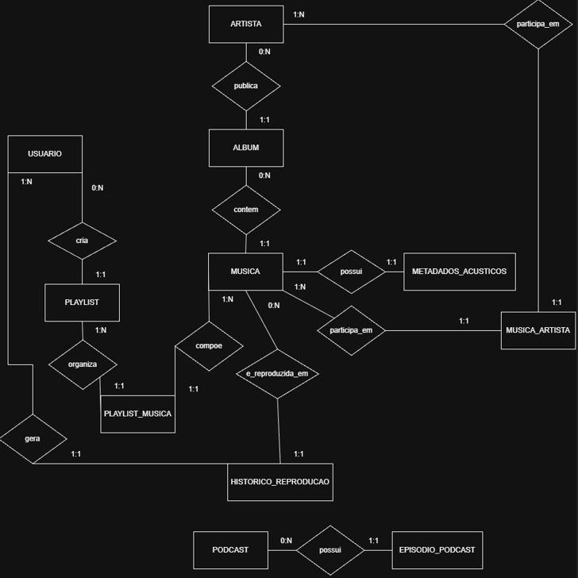
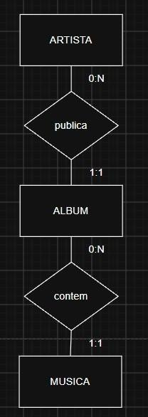
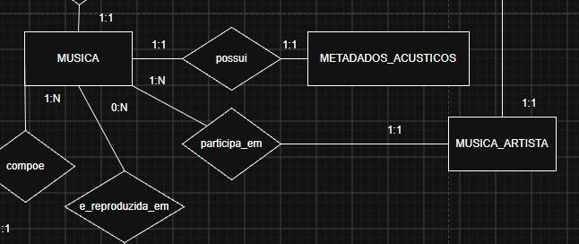
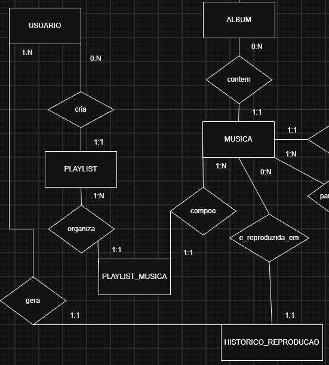
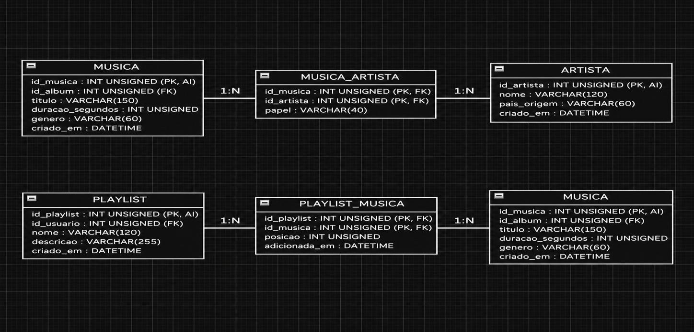
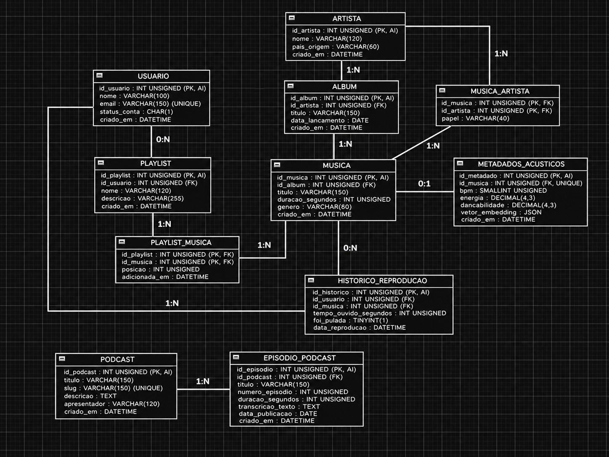

# streaming_db

Banco de dados relacional de uma **plataforma de streaming de músicas e podcasts**, com telemetria de consumo e um motor de recomendação acústica executado em SQL puro.


## Sumário

1. [Visão geral](#1-visão-geral)
2. [Modelagem](#2-modelagem)
3. [Estrutura do repositório](#3-estrutura-do-repositório)
4. [Requisitos e instalação](#4-requisitos-e-instalação)
5. [Uso](#5-uso)
6. [Manutenção](#6-manutenção)
7. [Informações do projeto](#7-informações-do-projeto)

---

## 1. Visão geral

### 1.1 O que o banco armazena

O `streaming_db` unifica em um só esquema três domínios:

| Domínio | O que armazena |
|---------|----------------|
| **Catálogo musical** | Artistas, álbuns, músicas, participação de vários artistas por faixa e metadados acústicos (BPM, energia, dançabilidade e vetor de 4 componentes) |
| **Podcasts** | Programas e episódios, com a transcrição textual de cada episódio |
| **Consumo** | Usuários, playlists ordenadas e o histórico de reprodução, com tempo ouvido e indicador de *skip* por evento |

**Problema que resolve:** concentrar catálogo e consumo no mesmo modelo relacional permite medir engajamento (quais faixas são puladas, quanto tempo se escuta, quais playlists crescem) e recomendar músicas parecidas **sem serviços externos**: a similaridade é calculada dentro do banco pela distância euclidiana entre os vetores acústicos.

**Em números:** 11 tabelas · 59 colunas · 11 chaves estrangeiras nomeadas · 10 restrições `CHECK` nomeadas · 15 consultas analíticas e 1 view.

### 1.2 Contexto

Projeto **acadêmico**, desenvolvido para a disciplina de **Banco de Dados** do curso de Engenharia da Computação da **AFYA Centro Universitário** (semestre 2026.1). Não se destina a um cliente específico nem acompanha uma aplicação: o repositório entrega apenas a camada de dados (esquema, carga e consultas).

**Objetivos**

- Modelar um domínio real em, no mínimo, 8 tabelas, com 2 relações N:N resolvidas por tabelas associativas.
- Implementar o esquema com integridade referencial e de domínio (`PK`, `FK`, `UNIQUE`, `NOT NULL`, `DEFAULT`, `CHECK`) e normalizá-lo até a 3FN.
- Popular o banco com dados realistas (músicas reais) e escrever consultas analíticas, inclusive de recomendação.

### 1.3 SGBD

**MySQL 8.4** (compatível com 8.0+), engine **InnoDB**, charset `utf8mb4` e collation `utf8mb4_unicode_ci`. Ambiente de desenvolvimento: **DBeaver**.

---

## 2. Modelagem

### 2.1 Diagrama entidade-relacionamento

DER conceitual completo, na notação retângulo–losango (11 entidades e 11 relacionamentos):



Os quatro recortes do DER, cada um ampliando uma parte do diagrama:

| Recorte | Conteúdo |
|---------|----------|
|  | **Artistas, álbuns e músicas:** hierarquia 1:N em cascata (`publica` e `contem`) |
|  | **Músicas, metadados e participação:** relação `possui` (1:0..1) e a associativa `musica_artista` |
|  | **Podcasts e episódios:** relação 1:N isolada do catálogo musical |
|  | **Usuários, playlists e histórico:** `cria`, `organiza`, `compoe`, `gera` e `e_reproduzida_em` |

Cada recorte é descrito em detalhe (entidades, rótulos de cardinalidade, FKs e ações referenciais) na seção 4 do [relatório técnico](./RELATORIO.md#4-diagrama-entidade-relacionamento-der--diagrama-de-classes).

As duas relações N:N, materializadas por tabelas associativas:



### 2.2 Modelo lógico/físico

Modelo relacional com os 11 objetos do esquema, tipos, chaves e cardinalidades. É o desenho que reflete o esquema físico efetivamente implementado:



### 2.3 Principais tabelas

| Tabela | Finalidade |
|--------|-----------|
| `usuario` | Conta do ouvinte, com situação (`A` ativa, `I` inativa, `S` suspensa) |
| `artista` | Artistas e bandas do catálogo |
| `album` | Álbuns, sempre vinculados a um artista principal |
| `musica` | Faixas, sempre vinculadas a um álbum |
| `metadados_acusticos` | Atributos acústicos e vetor de 4 posições de uma música (no máximo um registro por música) |
| `musica_artista` | **Associativa N:N** entre músicas e artistas; guarda o `papel` do artista na faixa |
| `podcast` | Programas de podcast, com `slug` único |
| `episodio_podcast` | Episódios, com transcrição indexada por `FULLTEXT` |
| `playlist` | Playlists criadas pelos usuários |
| `playlist_musica` | **Associativa N:N** entre playlists e músicas; guarda `posicao` e `adicionada_em` |
| `historico_reproducao` | Eventos de reprodução (tempo ouvido e *skip*); tabela de eventos, com PK própria |

| Relação | Cardinalidade | Ação ao excluir o registro pai |
|---------|---------------|--------------------------------|
| `artista` → `album` | 1:N | `RESTRICT` |
| `album` → `musica` | 1:N | `RESTRICT` |
| `musica` → `metadados_acusticos` | 1:0..1 (`UNIQUE`) | `CASCADE` |
| `musica` ↔ `artista` | N:N (`musica_artista`) | `CASCADE` |
| `playlist` ↔ `musica` | N:N (`playlist_musica`) | `CASCADE` |
| `usuario` → `playlist` | 1:N | `CASCADE` |
| `usuario` → `historico_reproducao` | 1:N | `CASCADE` |
| `musica` → `historico_reproducao` | 1:N | `CASCADE` |
| `podcast` → `episodio_podcast` | 1:N | `CASCADE` |

`historico_reproducao` não é associativa de chave composta: o mesmo usuário pode ouvir a mesma música várias vezes, então cada linha é um evento com `id_historico` próprio.

### 2.4 Dicionário de dados

Legenda: **PK** chave primária · **FK** chave estrangeira · **AI** `AUTO_INCREMENT` · **NN** `NOT NULL` · **UQ** `UNIQUE` · **CK** `CHECK` · **DF** `DEFAULT`.

#### `usuario`
Contas dos ouvintes da plataforma.

| Atributo | Tipo de Dado | Restrições | Descrição |
|----------|--------------|------------|-----------|
| `id_usuario` | INT UNSIGNED | PK, AI, NN | Identificador único da conta |
| `nome` | VARCHAR(100) | NN | Nome do usuário |
| `email` | VARCHAR(150) | NN, UQ (`uq_usuario_email`) | E-mail, sem duplicidade |
| `status_conta` | CHAR(1) | NN, DF `'A'`, CK (`ck_usuario_status_conta`: A, I ou S) | Situação da conta |
| `criado_em` | DATETIME | NN, DF `CURRENT_TIMESTAMP` | Data e hora de criação |

#### `artista`
Artistas e bandas do catálogo.

| Atributo | Tipo de Dado | Restrições | Descrição |
|----------|--------------|------------|-----------|
| `id_artista` | INT UNSIGNED | PK, AI, NN | Identificador único do artista |
| `nome` | VARCHAR(120) | NN | Nome do artista ou banda |
| `pais_origem` | VARCHAR(60) | — (opcional) | País de origem |
| `criado_em` | DATETIME | NN, DF `CURRENT_TIMESTAMP` | Data e hora de criação |

#### `podcast`
Programas de podcast.

| Atributo | Tipo de Dado | Restrições | Descrição |
|----------|--------------|------------|-----------|
| `id_podcast` | INT UNSIGNED | PK, AI, NN | Identificador único do podcast |
| `titulo` | VARCHAR(150) | NN | Título do programa |
| `slug` | VARCHAR(150) | NN, UQ (`uq_podcast_slug`) | Identificador textual exclusivo |
| `descricao` | TEXT | — (opcional) | Descrição do programa |
| `apresentador` | VARCHAR(120) | — (opcional) | Nome do apresentador |
| `criado_em` | DATETIME | NN, DF `CURRENT_TIMESTAMP` | Data e hora de criação |

#### `album`
Álbuns vinculados a um artista principal.

| Atributo | Tipo de Dado | Restrições | Descrição |
|----------|--------------|------------|-----------|
| `id_album` | INT UNSIGNED | PK, AI, NN | Identificador único do álbum |
| `id_artista` | INT UNSIGNED | FK (`fk_album_artista`), NN | Artista principal do álbum |
| `titulo` | VARCHAR(150) | NN | Título do álbum |
| `data_lancamento` | DATE | — (opcional) | Data de lançamento |
| `criado_em` | DATETIME | NN, DF `CURRENT_TIMESTAMP` | Data e hora de criação |

#### `musica`
Faixas musicais, cada uma ligada a um álbum.

| Atributo | Tipo de Dado | Restrições | Descrição |
|----------|--------------|------------|-----------|
| `id_musica` | INT UNSIGNED | PK, AI, NN | Identificador único da música |
| `id_album` | INT UNSIGNED | FK (`fk_musica_album`), NN | Álbum da faixa |
| `titulo` | VARCHAR(150) | NN, FULLTEXT (`ft_musica_titulo`) | Título, indexado para busca textual |
| `duracao_segundos` | INT UNSIGNED | NN, CK (`ck_musica_duracao`: > 0) | Duração em segundos |
| `genero` | VARCHAR(60) | — (opcional) | Gênero musical |
| `criado_em` | DATETIME | NN, DF `CURRENT_TIMESTAMP` | Data e hora de criação |

#### `episodio_podcast`
Episódios associados a podcasts.

| Atributo | Tipo de Dado | Restrições | Descrição |
|----------|--------------|------------|-----------|
| `id_episodio` | INT UNSIGNED | PK, AI, NN | Identificador único do episódio |
| `id_podcast` | INT UNSIGNED | FK (`fk_episodio_podcast`), NN | Podcast do episódio |
| `titulo` | VARCHAR(150) | NN | Título do episódio |
| `numero_episodio` | INT UNSIGNED | NN | Número do episódio no programa |
| `duracao_segundos` | INT UNSIGNED | NN, CK (`ck_episodio_duracao`: > 0) | Duração em segundos |
| `transcricao_texto` | TEXT | FULLTEXT (`ft_episodio_transcricao`), opcional | Transcrição para busca textual |
| `data_publicacao` | DATE | — (opcional) | Data de publicação |
| `criado_em` | DATETIME | NN, DF `CURRENT_TIMESTAMP` | Data e hora de criação |

#### `metadados_acusticos`
Parâmetros acústicos de uma música (no máximo um registro por música).

| Atributo | Tipo de Dado | Restrições | Descrição |
|----------|--------------|------------|-----------|
| `id_metadado` | INT UNSIGNED | PK, AI, NN | Identificador do registro |
| `id_musica` | INT UNSIGNED | FK (`fk_metadados_musica`), UQ (`uq_metadados_musica`), NN | Música descrita |
| `bpm` | SMALLINT UNSIGNED | NN, CK (`ck_metadados_bpm`: 30 a 300) | Batidas por minuto |
| `energia` | DECIMAL(4,3) | NN, CK (`ck_metadados_energia`: 0 a 1) | Energia acústica |
| `dancabilidade` | DECIMAL(4,3) | NN, CK (`ck_metadados_dancabilidade`: 0 a 1) | Adequação para dança |
| `vetor_embedding` | JSON | NN, CK (`ck_metadados_vetor`: `JSON_LENGTH = 4`) | Vetor acústico de 4 componentes |
| `criado_em` | DATETIME | NN, DF `CURRENT_TIMESTAMP` | Data e hora de criação |

#### `musica_artista`
Associativa N:N entre músicas e artistas.

| Atributo | Tipo de Dado | Restrições | Descrição |
|----------|--------------|------------|-----------|
| `id_musica` | INT UNSIGNED | PK composta, FK (`fk_ma_musica`), NN | Música associada |
| `id_artista` | INT UNSIGNED | PK composta, FK (`fk_ma_artista`), NN | Artista associado |
| `papel` | VARCHAR(40) | NN, DF `'principal'` | Função do artista na faixa |

#### `playlist`
Listas de músicas criadas pelos usuários.

| Atributo | Tipo de Dado | Restrições | Descrição |
|----------|--------------|------------|-----------|
| `id_playlist` | INT UNSIGNED | PK, AI, NN | Identificador único da playlist |
| `id_usuario` | INT UNSIGNED | FK (`fk_playlist_usuario`), NN | Usuário proprietário |
| `nome` | VARCHAR(120) | NN | Nome da playlist |
| `descricao` | VARCHAR(255) | — (opcional) | Descrição |
| `criado_em` | DATETIME | NN, DF `CURRENT_TIMESTAMP` | Data e hora de criação |

#### `playlist_musica`
Associativa N:N entre playlists e músicas.

| Atributo | Tipo de Dado | Restrições | Descrição |
|----------|--------------|------------|-----------|
| `id_playlist` | INT UNSIGNED | PK composta, FK (`fk_pm_playlist`), NN | Playlist associada |
| `id_musica` | INT UNSIGNED | PK composta, FK (`fk_pm_musica`), NN | Música incluída |
| `posicao` | INT UNSIGNED | NN, CK (`ck_pm_posicao`: > 0) | Posição na playlist |
| `adicionada_em` | DATETIME | NN, DF `CURRENT_TIMESTAMP` | Data e hora da inclusão |

#### `historico_reproducao`
Telemetria de consumo: um registro por reprodução.

| Atributo | Tipo de Dado | Restrições | Descrição |
|----------|--------------|------------|-----------|
| `id_historico` | INT UNSIGNED | PK, AI, NN | Identificador do evento |
| `id_usuario` | INT UNSIGNED | FK (`fk_hist_usuario`), NN | Usuário que ouviu |
| `id_musica` | INT UNSIGNED | FK (`fk_hist_musica`), NN | Música reproduzida |
| `tempo_ouvido_segundos` | INT UNSIGNED | NN, CK (`ck_hist_tempo`: >= 0) | Tempo efetivamente ouvido |
| `foi_pulada` | TINYINT(1) | NN, DF `0`, CK (`ck_hist_pulada`: 0 ou 1) | Indicador de *skip* |
| `data_reproducao` | DATETIME | NN, DF `CURRENT_TIMESTAMP` | Data e hora da reprodução |

### 2.5 Regras de negócio que influenciaram o modelo

| Código | Regra | Como foi implementada |
|--------|-------|-----------------------|
| RN01 | Cada conta tem um e-mail exclusivo e uma situação: ativa (`A`), inativa (`I`) ou suspensa (`S`) | `UNIQUE` em `email`; `CHECK` e `DEFAULT 'A'` em `status_conta` |
| RN02 | Todo álbum pertence a um artista e toda música a um álbum | FKs `NOT NULL` com `RESTRICT` |
| RN03 | Uma música pode ter vários artistas (participações), cada um com seu papel | Associativa `musica_artista` com `papel` (padrão `'principal'`) |
| RN04 | Uma música tem no máximo um conjunto de metadados acústicos | `UNIQUE` em `metadados_acusticos.id_musica` |
| RN05 | Andamento entre 30 e 300 BPM; energia e dançabilidade entre 0 e 1; vetor com 4 componentes | `CHECK` nomeados (`ck_`) |
| RN06 | Playlists pertencem a um usuário e mantêm a ordem das faixas; a mesma música pode estar em várias playlists | FK em `playlist`; associativa `playlist_musica` com `posicao > 0` |
| RN07 | Cada reprodução é um evento registrado, com tempo ouvido e indicador de *skip* | `historico_reproducao` com PK própria; `CHECK` em `tempo_ouvido_segundos` e `foi_pulada` |
| RN08 | Um podcast tem vários episódios; o `slug` do podcast é exclusivo; a duração do episódio é positiva | FK `CASCADE`; `UNIQUE` em `slug`; `CHECK` em `duracao_segundos` |
| RN09 | Não se exclui artista nem álbum que ainda tenham dependentes | `ON DELETE RESTRICT` na hierarquia do catálogo |
| RN10 | Ao excluir um usuário, suas playlists e seu histórico são removidos; ao excluir uma playlist, seus itens são removidos (as músicas permanecem) | `ON DELETE CASCADE` |
| RN11 | Transcrições de episódios e títulos de músicas devem ser pesquisáveis por texto | Índices `FULLTEXT` |

### 2.6 Justificativa das decisões de modelagem

- **Associativas com atributos próprios** (`papel`, `posicao`, `adicionada_em`), porque esses dados descrevem o vínculo e não pertencem a nenhum dos lados.
- **Histórico como tabela de eventos**, para permitir várias reproduções do mesmo par usuário/música e métricas de *skip* e tempo ouvido.
- **Vetor em `JSON` com `CHECK` de tamanho**, para manter o cálculo vetorial dentro do SGBD sem alterar o esquema a cada dimensão. O vetor é tratado como um único valor de domínio (justificativa da 1FN no relatório).
- **`RESTRICT` no catálogo e `CASCADE` nos dependentes**, protegendo a hierarquia sem deixar registros órfãos.
- **Nenhum atributo derivado armazenado:** totais de reprodução saem de consulta ou da view, o que mantém o esquema em 3FN.

A normalização até a 3FN, com um exemplo de decomposição, está na seção 6 do [relatório técnico](./RELATORIO.md).

---

## 3. Estrutura do repositório

```text
streaming-db/
├── README.md                              # Este arquivo
├── RELATORIO.md                           # Relatório técnico completo (10 seções do edital)
├── dump_completo.sql                      # Banco completo: estrutura + dados (restauração rápida)
├── .env.example                           # Modelo de variáveis de ambiente (sem senhas reais)
├── .gitignore                             # Impede o commit do arquivo .env e de backups locais
├── schema/
│   └── etapa3_ddl_streaming_ia_db.sql     # Scripts DDL: criação das tabelas
├── queries/
│   └── consultas_dbeaver.sql              # Consultas Q1 a Q15 e a view, comentadas
└── docs/                                  # Diagramas
    ├── der_conceitual.png
    ├── der_streaming_db.png
    ├── recorte_1_artista_album_musica.png
    ├── recorte_2_musica_metadados_associativa.png
    ├── recorte_3_podcast_episodio.png
    ├── recorte_4_usuario_playlist_historico.png
    ├── associacoes_nn.png
    └── fluxo_recomendacao.png
```

| Pasta ou arquivo | Conteúdo |
|------------------|----------|
| `docs/` | Diagramas e figuras citadas neste README e no relatório |
| `schema/` | DDL: criação das tabelas, restrições e índices |
| `queries/` | Consultas e a view `vw_catalogo_inteligente` |
| `dump_completo.sql` | Estrutura e dados juntos; é a forma mais rápida de ter o banco populado |
| `migrations/`, `seeds/` | **Não existem neste projeto.** O esquema tem uma única versão (DDL) e os dados iniciais acompanham o dump |

---

## 4. Requisitos e instalação

### 4.1 Pré-requisitos

- **MySQL Server 8.0+** (testado no 8.4) com InnoDB, **ou** Docker
- Cliente `mysql` (linha de comando), **DBeaver** ou **MySQL Workbench**
- Git (para clonar o repositório)
- Nenhuma extensão adicional é necessária

### 4.2 Configuração de conexão

Nenhuma senha real fica no repositório. Copie o modelo e preencha com valores locais:

```bash
cp .env.example .env
# edite o .env e defina senhas fortes
set -a; source .env; set +a      # carrega as variáveis na sessão do terminal
```

Conteúdo do `.env.example`:

```dotenv
DB_HOST=127.0.0.1
DB_PORT=3306
DB_NAME=streaming_db
DB_USER=streaming_app
DB_PASSWORD=defina_uma_senha_forte
MYSQL_ROOT_PASSWORD=defina_uma_senha_forte
```

O `.env` está no `.gitignore` e **nunca deve ser enviado ao GitHub**.

### 4.3 Instalação com MySQL local

Execute na raiz do repositório, **nesta ordem**:

```bash
git clone https://github.com/MatheusMarques950/streaming-db.git
cd streaming-db

# 1) Criar o banco
mysql -h "$DB_HOST" -P "$DB_PORT" -u root -p \
  -e "CREATE DATABASE IF NOT EXISTS $DB_NAME CHARACTER SET utf8mb4 COLLATE utf8mb4_unicode_ci;"

# 2) Restaurar estrutura e dados (opção rápida)
mysql -h "$DB_HOST" -P "$DB_PORT" -u root -p "$DB_NAME" < dump_completo.sql
```

Para criar **somente a estrutura**, sem dados, use o DDL no lugar do dump:

```bash
mysql -h "$DB_HOST" -P "$DB_PORT" -u root -p "$DB_NAME" < schema/etapa3_ddl_streaming_ia_db.sql
```

### 4.4 Instalação com Docker

```bash
docker run --name streaming-mysql --env-file .env -p 3306:3306 -d mysql:8.4

# aguardar o servidor aceitar conexões
until docker exec streaming-mysql mysqladmin ping -uroot -p"$MYSQL_ROOT_PASSWORD" --silent; do sleep 2; done

docker exec streaming-mysql mysql -uroot -p"$MYSQL_ROOT_PASSWORD" \
  -e "CREATE DATABASE IF NOT EXISTS $DB_NAME CHARACTER SET utf8mb4 COLLATE utf8mb4_unicode_ci;"
docker exec -i streaming-mysql mysql -uroot -p"$MYSQL_ROOT_PASSWORD" "$DB_NAME" < dump_completo.sql
```

### 4.5 DBeaver / MySQL Workbench

1. Crie a conexão com o servidor e o banco `streaming_db` (`utf8mb4` / `utf8mb4_unicode_ci`).
2. Abra `dump_completo.sql` e execute como **script completo** (DBeaver: `Alt + X`).
3. Abra `queries/consultas_dbeaver.sql` e execute uma consulta por vez (`Ctrl + Enter`).

### 4.6 Verificação da instalação

```sql
USE streaming_db;
SHOW TABLES;                                  -- deve listar 11 tabelas
SELECT COUNT(*) AS musicas FROM musica;       -- carga mínima: 15 registros
SELECT COUNT(*) AS plays FROM historico_reproducao;

SELECT TABLE_NAME, CONSTRAINT_NAME, CONSTRAINT_TYPE
FROM information_schema.TABLE_CONSTRAINTS
WHERE TABLE_SCHEMA = 'streaming_db'
ORDER BY CONSTRAINT_TYPE, TABLE_NAME;
```

---

## 5. Uso

### 5.1 Consultas importantes

Todas as consultas estão em [`queries/consultas_dbeaver.sql`](./queries/consultas_dbeaver.sql), cada uma com a pergunta de negócio em comentário. O código completo, com saída esperada, está no [relatório](./RELATORIO.md#7-catálogo-de-consultas-dql-e-motor-de-recomendação-acústica).

| Consultas | Categoria | Recursos |
|-----------|-----------|----------|
| Q1 a Q5 | Simples | `WHERE`, `ORDER BY`, `LIKE`, `BETWEEN`, `IN`, `DISTINCT`, `LIMIT` |
| Q6 a Q10 | Analíticas | `INNER JOIN` (2 a 4 tabelas), `GROUP BY`, `HAVING`, `COUNT`, `SUM`, `AVG`, `MAX`, `MIN` |
| Q11 | Subconsulta | Músicas com energia acima da média |
| Q12 | `LEFT JOIN` | Músicas nunca reproduzidas |
| Q13 | `FULLTEXT` | Busca em transcrições de podcasts |
| Q14 e Q15 | Recomendação | Distância euclidiana (3 atributos e vetor JSON de 4 posições) |

**Taxa de *skip* por artista** (consulta 9):

```sql
SELECT a.nome AS artista,
       COUNT(*) AS total_reproducoes,
       SUM(h.foi_pulada) AS total_skips,
       ROUND(100 * AVG(h.foi_pulada), 1) AS taxa_skip_pct
FROM historico_reproducao h
INNER JOIN musica_artista mar ON mar.id_musica = h.id_musica AND mar.papel = 'principal'
INNER JOIN artista a ON a.id_artista = mar.id_artista
GROUP BY a.id_artista, a.nome
HAVING COUNT(*) >= 3
ORDER BY taxa_skip_pct DESC;
```

**Busca textual em transcrições** (consulta 13):

```sql
SELECT p.titulo AS podcast, e.titulo AS episodio,
       MATCH(e.transcricao_texto) AGAINST('tecnologia' IN NATURAL LANGUAGE MODE) AS relevancia
FROM episodio_podcast e
INNER JOIN podcast p ON p.id_podcast = e.id_podcast
WHERE MATCH(e.transcricao_texto) AGAINST('tecnologia' IN NATURAL LANGUAGE MODE)
ORDER BY relevancia DESC;
```

### 5.2 Motor de recomendação acústica

Cada música tem um vetor `v = (v1, v2, v3, v4)` em `metadados_acusticos.vetor_embedding`. A similaridade é a **distância euclidiana**; quanto menor, mais parecidas são as faixas:

```text
d(x, y) = sqrt( (x1 - y1)^2 + (x2 - y2)^2 + (x3 - y3)^2 + (x4 - y4)^2 )
```


Cinco músicas mais próximas de *Afterlife* (consulta 15):

```sql
WITH vetores AS (
    SELECT m.id_musica, m.titulo,
           CAST(JSON_UNQUOTE(JSON_EXTRACT(ma.vetor_embedding, '$[0]')) AS DECIMAL(10,6)) AS v1,
           CAST(JSON_UNQUOTE(JSON_EXTRACT(ma.vetor_embedding, '$[1]')) AS DECIMAL(10,6)) AS v2,
           CAST(JSON_UNQUOTE(JSON_EXTRACT(ma.vetor_embedding, '$[2]')) AS DECIMAL(10,6)) AS v3,
           CAST(JSON_UNQUOTE(JSON_EXTRACT(ma.vetor_embedding, '$[3]')) AS DECIMAL(10,6)) AS v4
    FROM musica m
    INNER JOIN metadados_acusticos ma ON ma.id_musica = m.id_musica
)
SELECT c.titulo, a.nome AS artista,
       ROUND(SQRT(POW(c.v1 - r.v1, 2) + POW(c.v2 - r.v2, 2) +
                  POW(c.v3 - r.v3, 2) + POW(c.v4 - r.v4, 2)), 4) AS distancia_acustica
FROM vetores r
INNER JOIN vetores c ON c.id_musica <> r.id_musica
INNER JOIN musica_artista mar ON mar.id_musica = c.id_musica AND mar.papel = 'principal'
INNER JOIN artista a ON a.id_artista = mar.id_artista
WHERE r.titulo = 'Afterlife'
ORDER BY distancia_acustica ASC
LIMIT 5;
```

### 5.3 Views, funções, procedures, triggers e índices

| Objeto | Situação |
|--------|----------|
| **View** `vw_catalogo_inteligente` | Consolida música, artista principal, álbum, BPM, energia, dançabilidade e total de reproduções (definição em `queries/consultas_dbeaver.sql`) |
| Funções, *stored procedures* e *triggers* | **Não há.** A recomendação é uma consulta; encapsulá-la em procedure está no roadmap |
| Índices `FULLTEXT` | `episodio_podcast.transcricao_texto` e `musica.titulo` |
| Índices `B-Tree` compostos | `historico_reproducao` (usuário/período e música/*skip*) e `metadados_acusticos` (BPM/energia e energia/dançabilidade) |
| Índices implícitos | PKs, `UNIQUE` e FKs |

Uso da view:

```sql
SELECT musica, artista_principal, album, total_reproducoes
FROM vw_catalogo_inteligente
ORDER BY total_reproducoes DESC
LIMIT 10;
```

### 5.4 Como popular com dados de exemplo

O `dump_completo.sql` já contém a carga: **15 músicas reais** (Evanescence, Linkin Park, Grioten, Skillet, AniRap, KALEO, Guns N' Roses, AC/DC, Nirvana, Bon Jovi, Queen, Pink Floyd, The White Stripes, Foo Fighters e System Of A Down), com 15 registros nas entidades principais, 38 itens em `playlist_musica` e 38 reproduções em `historico_reproducao`. Uma das músicas não tem nenhuma reprodução, de propósito, para demonstrar o `LEFT JOIN` (consulta 12).

Para recarregar do zero: `DROP DATABASE streaming_db;`, recrie o banco e repita a seção 4.3.

---

## 6. Manutenção

### 6.1 Migrações

O projeto tem uma única versão do esquema, mantida em `schema/`. Não há ferramenta de migração. Para evoluir o esquema, siga este fluxo:

1. Crie o `ALTER TABLE` em um arquivo novo, nomeado com versão e descrição (ex.: `schema/V2__tabela_dominio_status_conta.sql`).
2. Teste em um banco descartável restaurado a partir do dump.
3. Atualize `schema/etapa3_ddl_streaming_ia_db.sql` e o dicionário de dados neste README.
4. Faça o commit com uma mensagem descritiva.

### 6.2 Backup e restauração

```bash
# Backup completo (estrutura, dados, rotinas e triggers), consistente para InnoDB
mysqldump -u root -p --single-transaction --routines --triggers \
  --default-character-set=utf8mb4 --databases streaming_db > backup_streaming_db_$(date +%F).sql

# Restauração
mysql -u root -p < backup_streaming_db_2026-11-15.sql
```

Os arquivos `backup_*.sql` estão no `.gitignore`. Guarde-os fora do repositório. Em produção, agende o `mysqldump` (cron) e teste a restauração periodicamente.

### 6.3 Desempenho

- Os índices compostos em `historico_reproducao` e `metadados_acusticos` atendem aos filtros e às agregações mais frequentes. Use `EXPLAIN` antes de criar novos índices:

  ```sql
  EXPLAIN SELECT * FROM historico_reproducao
  WHERE id_usuario = 1 AND data_reproducao >= '2026-01-01';
  ```

- A recomendação compara a faixa de referência com **todo o catálogo** (varredura completa). Para volumes maiores, pré-calcule as distâncias ou use índice vetorial.
- O índice `FULLTEXT` do InnoDB ignora palavras muito curtas e *stopwords* (parâmetro `innodb_ft_min_token_size`); escolha termos de busca adequados.
- Com milhões de linhas, considere particionar `historico_reproducao` por data.

### 6.4 Segurança

- **Não use o usuário `root` na aplicação.** Crie usuários com privilégio mínimo:

  ```sql
  -- aplicação: leitura e escrita nas tabelas do banco, sem DDL
  CREATE USER 'streaming_app'@'localhost' IDENTIFIED BY 'defina_uma_senha_forte';
  GRANT SELECT, INSERT, UPDATE, DELETE ON streaming_db.* TO 'streaming_app'@'localhost';

  -- analista: somente leitura
  CREATE USER 'streaming_leitura'@'localhost' IDENTIFIED BY 'defina_uma_senha_forte';
  GRANT SELECT ON streaming_db.* TO 'streaming_leitura'@'localhost';
  ```

- Mantenha senhas apenas no `.env` (fora do Git) e restrinja o acesso de rede à porta 3306.
- A tabela `usuario` guarda nome e e-mail: trate esses dados conforme a LGPD ao usar dados reais. O dump deste projeto contém apenas dados fictícios de usuários.
- Nunca faça commit de dumps com dados reais.

---

## 7. Informações do projeto

### 7.1 Tecnologias

MySQL 8.4 · InnoDB · SQL (DDL, DML e DQL) · DBeaver · Git e GitHub · Docker (opcional)

### 7.2 Autores

| Nome | GitHub |
|------|--------|
| Pedro Henrique Melgaço de Oliveira | [adicionar usuário do GitHub] |
| Matheus Gonçalves Marques | [@MatheusMarques950](https://github.com/MatheusMarques950) |

Projeto desenvolvido no curso de Engenharia da Computação da AFYA Centro Universitário, disciplina de Banco de Dados, 2026.1.

### 7.3 Licença

Trabalho acadêmico, **sem licença de código aberto definida**: até que um arquivo `LICENSE` seja adicionado, todos os direitos permanecem com os autores. Para permitir reutilização, adicione uma licença (por exemplo, MIT) na raiz do repositório.

### 7.4 Como contribuir

Contribuições são bem-vindas por *issue* ou *pull request*:

1. Faça um *fork* e crie uma branch (`git checkout -b melhoria/descricao`).
2. Mantenha as convenções: nomes em `snake_case`, em português e sem acentos; FKs com prefixo `fk_`, `CHECK` com `ck_` e `UNIQUE` com `uq_`.
3. Teste o passo a passo da seção 4 em um banco limpo antes de enviar.
4. Abra o *pull request* descrevendo a mudança e atualizando o dicionário de dados, se o esquema mudar.

### 7.5 Roadmap e limitações conhecidas

**Limitações**

- O banco valida o **tamanho** do vetor JSON, mas não que os elementos sejam numéricos.
- A recomendação faz varredura completa do catálogo.
- O significado dos status `A/I/S` e a regra "uma participação principal por música" não são impostos pelo esquema.

**Próximos passos**

1. Vetor em quatro colunas `DECIMAL` (atomicidade plena na 1FN) ou tipo vetorial nativo, quando disponível.
2. Tabela de domínio para `status_conta` e `UNIQUE (id_playlist, posicao)`.
3. *Stored procedure* `recomendar_musicas(id_musica, limite)`.
4. Assinaturas/planos e histórico de episódios de podcast.
5. Particionamento de `historico_reproducao` por data.

### 7.6 Documentação complementar e referências

- **Relatório técnico completo:** [`RELATORIO.md`](./RELATORIO.md) (domínio, DER e recortes, dicionário de dados, normalização até a 3FN, catálogo de consultas e matriz de conformidade com o edital).
- ELMASRI, R.; NAVATHE, S. B. *Sistemas de Banco de Dados*. 7. ed. Pearson, 2018.
- SILBERSCHATZ, A.; KORTH, H. F.; SUDARSHAN, S. *Sistema de Banco de Dados*. 6. ed. Elsevier, 2012.
- DATE, C. J. *Introdução a Sistemas de Bancos de Dados*. 8. ed. Elsevier/Campus, 2004.
- ORACLE. *MySQL 8.4 Reference Manual*. https://dev.mysql.com/doc/refman/8.4/en/
